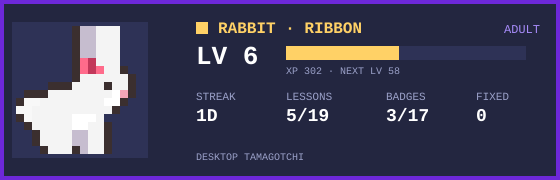

- **Desktop Tamagotchi** — 바탕화면을 돌아다니는 픽셀 펫이 개발 중인 localhost 페이지의 접근성·반응형 누락을 고치는 방법과 함께 알려 주는 Windows 앱 · [Release](https://github.com/junhooo111/desktop-tamagotchi/releases)
- **AI Debate Arena** — 두 AI가 찬반 토론하고 사람이 승자를 고르는 웹앱 · [Demo](https://ai-debate-arena-gray.vercel.app)

- **kr-skill-release-check** — 공개 전에 기밀과 개인정보를 점검하는 스킬 · [Repo](https://github.com/junhooo111/kr-skill-release-check)
- **echarts-interaction-perf** — 조작할 때 버벅이는 ECharts 차트를 측정부터 시작해 진단하는 스킬 (프로파일 스크립트, 재현 가능한 벤치마크 포함) · [Repo](https://github.com/junhooo111/echarts-interaction-perf)

